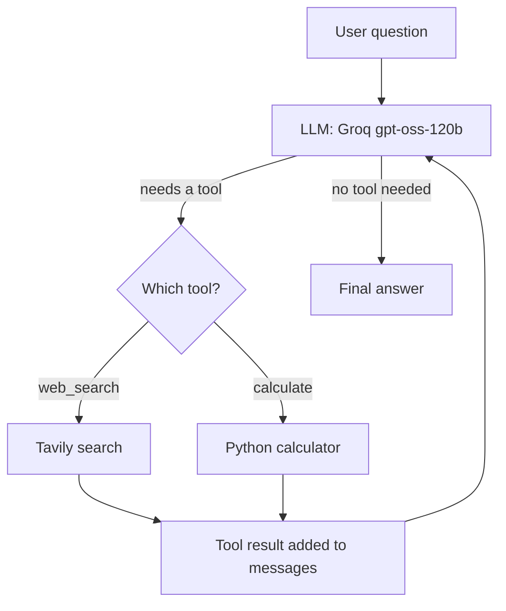

# 🤖 AI Research Agent — Web Search + Calculator

A tool-calling AI agent built with **Groq** (`openai/gpt-oss-120b`) and **Tavily**.
Give it any question: the LLM **decides on its own** whether to search the web, do a calculation, use both, or answer directly, and then returns a final answer with sources.

```
You: What is 15% of the current price of an iPhone in India?

--- Iteration 1 ---
LLM requested 1 tool(s)
Tool: web_search
Arguments: {'query': 'current iPhone price in India'}

--- Iteration 2 ---
LLM requested 1 tool(s)
Tool: calculate
Arguments: {'expression': '79900 * 0.15'}

--- Iteration 3 ---
FINAL ANSWER:
15% of ₹79,900 is ₹11,985. Source: https://...
```

---

## ✨ Features

- 🔎 **Web search** — real-time results from the internet through the Tavily API
- 🧮 **Calculator** — arithmetic, percentages, powers and brackets
- 🧠 **Automatic tool selection** — `tool_choice="auto"` lets the LLM choose the right tool
- 🔁 **Multi-step reasoning** — chains tools (e.g. search → calculate → answer)
- 🔗 **Cited answers** — includes source URLs from search results
- 🛑 **Iteration limit** — stops after 5 rounds so the agent never loops forever

---

## 🧩 How it works



1. The question and a **system prompt** are sent to the LLM along with the **tool definitions**.
2. The LLM either answers directly **or** returns a `tool_calls` request (tool name + JSON arguments).
3. Python looks up the function in `AVAILABLE_TOOLS`, runs it, and sends the result back as a `tool` message.
4. Steps 2–3 repeat until the LLM has enough information to give a **final answer** (max 5 iterations).

---

## 🛠️ Tools

| Tool | Python function | When the LLM uses it | Argument |
|---|---|---|---|
| `web_search` | `web_search(query)` | Current or changing info — news, prices, statistics, recent events | `query` (string) |
| `calculate` | `calculate(expression)` | Math — percentages, multiplication, division, arithmetic | `expression` (string), e.g. `"2500 * 0.15"` |

### Tool definition format

Each tool is described to the LLM in the standard function-calling JSON schema:

```python
{
    "type": "function",              # this tool is a function
    "function": {
        "name": "calculate",         # name the LLM uses to call it
        "description": "...",        # tells the LLM WHEN to use it
        "parameters": {              # JSON schema of the arguments
            "type": "object",
            "properties": {
                "expression": {"type": "string", "description": "..."}
            },
            "required": ["expression"]
        }
    }
}
```

The **description** is the most important field: it is the only thing the LLM reads to decide which tool fits the question.

---

## 🚀 Getting started

### 1. Prerequisites
- Python 3.10+
- [uv](https://docs.astral.sh/uv/) (or pip)
- A **Groq API key** → [console.groq.com](https://console.groq.com)
- A **Tavily API key** → [app.tavily.com](https://app.tavily.com)

### 2. Install dependencies

```bash
uv add groq python-dotenv tavily-python
```

or with pip:

```bash
pip install groq python-dotenv tavily-python
```

> Note: the Tavily package is called **`tavily-python`** on PyPI (it is imported as `from tavily import TavilyClient`).

### 3. Add your API keys

Create a `.env` file in the project folder:

```env
GROQ_API_KEY=your_groq_api_key
TAVILY_API_KEY=your_tavily_api_key
```

> ⚠️ Never commit `.env` to GitHub — add it to `.gitignore`.

### 4. Run the agent

```bash
uv run main.py
```

Then type your question when asked:

```
============================================================
AI RESEARCH AGENT
============================================================

Ask me anything:
```

---

## 💬 Example questions

| Question | Tools used |
|---|---|
| `What is 2500 * 0.15?` | `calculate` |
| `Who won the latest Cricket World Cup?` | `web_search` |
| `What is the population of Japan divided by 1000?` | `web_search` → `calculate` |
| `What is 18% GST on the current price of a PS5 in India?` | `web_search` → `calculate` |
| `Explain what an API is` | none — answered directly |

---

## 📁 Project structure

```
.
├── main.py        # agent: tools, tool definitions, system prompt, agent loop
├── .env           # API keys (not committed)
└── README.md
```

---

## 🧠 Concepts used

- **Tool / function calling** — the LLM returns structured requests to run code
- **Agent loop** — think → act (call tool) → observe (read result) → repeat
- **ReAct pattern** — reasoning and acting in turns until the task is solved
- **`tool_choice="auto"`** — the model decides between tools or a direct answer
- **Conversation memory** — every tool call and result is appended to `messages`

---

## ⚠️ Limitations & security note

- `calculate` uses Python's `eval()` with built-ins disabled. This blocks simple misuse, but `eval()` is **not fully safe** for untrusted input. Before exposing this agent publicly (e.g. as an API), replace it with an AST-based evaluator or a math library such as `numexpr` or `sympy`.
- Web results depend on Tavily — answers are only as accurate as the sources found.
- The agent stops after **5 iterations**; very complex tasks may need a higher limit.

---

## 🔮 Possible improvements

- Safe AST-based calculator
- Chat mode with memory across multiple questions
- More tools: weather, Wikipedia, unit conversion, code execution
- Streaming responses
- A FastAPI endpoint or web UI

---

## 🧰 Tech stack

**Python** · **Groq API** (`openai/gpt-oss-120b`) · **Tavily Search API** · **python-dotenv**